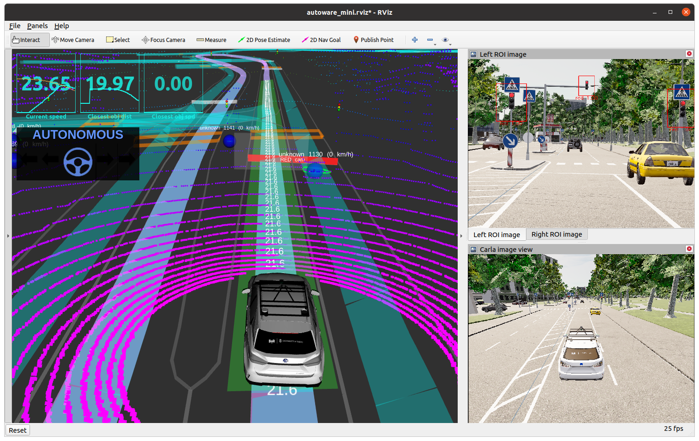

[< Previous practice](../practice_7) -- [**Main Readme**](../README.md)

# Practice 8 - CARLA simulator with Visual Scenario Editor

The task for this practice is to test your autonomous driving framework in the Carla simulator by using Visual Scenario Editor. You will use all the following nodes representing different modules of the autonomous driving stack written during previous practices:

* `localizer` - Localization module
* `points_clusterer` and `cluster_detector` - Perception module
* `camera_traffic_light_detector` - Traffic light detection module
* `lanelet2_global_planner` - Global planner module
* `local_path_extractor`,`collision_points_manager`, and `simple_speed_planner` - Local path extraction, collision points management, and speed planning modules
* `pure_pursuit_follower` - Controller module

You are provided with final launch files and RViz config file that utilizes all mentioned nodes and substitutes other useful nodes and CARLA simulator setup from `autoware_mini`. Additionally you are given an example scenario for Visual Scenario Editor that simulates obstacles, traffic lights and vehicle following on the part of the demo lap.

#### Additional files
- [practice_8.launch](launch/practice_8.launch) - Launch file that includes all modules from `autoware_mini_practice_solutions` package and launches Scenario Runner with pre-set route scenario, however, substitutes perception and traffic light detection modules with the ground truth readings provided by CARLA simulator.
- [rviz/practice_8.rviz](rviz/practice_8.rviz) - RViz config file for visualizing of the topics.
- [tartu_demo_route_simple.json](tartu_demo_route_simple.json) - Example scenario for Visual Scenario Editor that simulates obstacles, traffic lights and vehicle following on the part of the demo lap. Save it to your Visual Scenario Editor installer folder under `examples/tartu_demo` subfolder.
- [vse_play_scenario.xml](vse_play_scenario.xml) - Launch file for Visual Scenario Editor to run the example scenario. Save it to your Visual Scenario Editor installer folder under `examples/tartu_demo` subfolder.



## 1. Run the example simple VSE scenario

1. Launch Visual Scenario Editor. 
2. Open the example scenario `tartu_demo_route_simple`. The scenario contains preset ego-vehicle position, four pedestrians, and one vehicle down the road that your ego-vehicle should follow.
3. Press 'Play' in the upper-right corner and experiment with scenario in the manual control mode. Use arrow keys to control the ego-vehicle. Explore how pedestrians and the vehicle behave in the scenario.
4. Reset scenario and now run it together with your autonomous driving framework. To achieve this, first run the following command, wait until RViz initializes and then press 'Play' in Visual Scenario Editor.
    ```
    roslaunch autoware_mini_practice_solutions practice_8.launch use_scenario_runner:=true
    ```
5. Once the position of the vehicle in the RViz aligns with the position of the ego-vehicle in Visual Scenario Editor, set the destination down the road in RViz. Your autonomous driving framework should now control the ego-vehicle. 
6. Check if the ego-vehicle successfully reacts to pedestrian obstacles and follows the vehicle down the road. Did everything succeed? If not, try to adjust the obstacles positions and/or triggers in the Visual Scenario Editor and try again (hint: original scenario assumes that framework has obstacle motion prediction, while yours doesn't have it, so you will need triggers to be set a bit earlier).
7. Experiment and ensure that your framework is working correctly and behaves safely in the scenario. 

## 2. Modify the example VSE scenario

1. Once the framework passes the example scenario, your task is to modify the scenario to make it more challenging. You can add more pedestrians, vehicles, change their positions, speeds, and triggers.
2. Add at least three pedestrians crossing the road in front of the ego-vehicle at different distances. Add at least one vehicle that will cut in front of the ego-vehicle from another lane and one bus stop with a bus that will block the ego-vehicle's lane. You can experiment with the traffic triggers.
3. Ensure that the modified scenario is compact and the route is limited from the Delta building to the bridge crossing near Riia street. 
4. Once you are satisfied and your framework successfully handles the modified scenario, save it to a new JSON file named `tartu_demo_route_practice.json`.
5. Commit the final tunings of your framework in your repo and include the modified scenario JSON file and `vse_play_scenario.xml` launch file in the root of your repository.